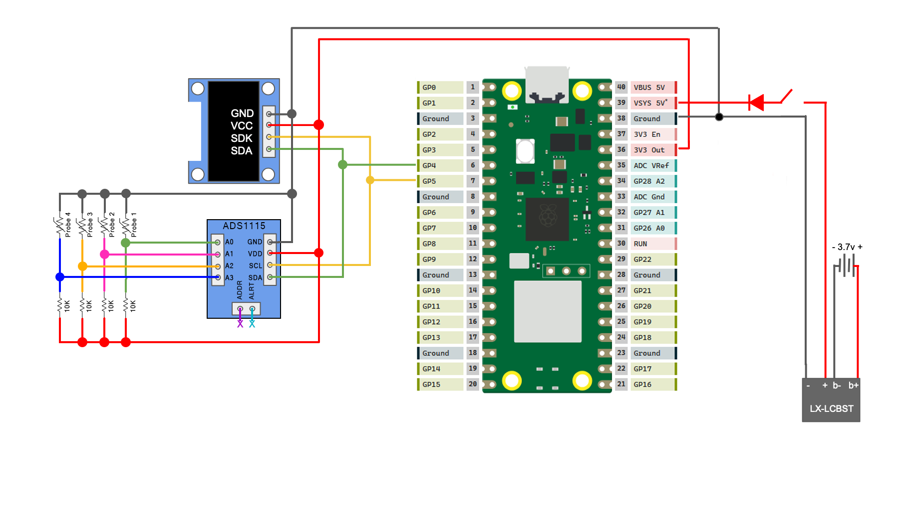

# Pi-tmaster-Improved

A WiFi BBQ thermometer built on a Raspberry Pi Pico 2W. Based on the fine 
work of [JayTongue/Pi-Tmaster](https://github.com/JayTongue/Pi-Tmaster)

I wanted to create a BBQ thermometer with a couple requirements:

1) Use the Weber iGrill2 temperature probes (thermistors) I already owned.
2) Be able to handle 1 to 4 probes, which can be plugged in or unplugged while it is running.
3) Connect to my home WiFi network so I can monitor it from my phone anywhere in my house.
4) Keeps temperature readings through a restart of the system or a loss of network connection.

------------------------------------------------
## 1. Hardware

### Microcontroller

I used a Raspberry Pi Pico 2W that I already had, but a Pico W should work just as well. The project 
stores temperature history in a filesystem on the Pico's flash, so in the Arduino IDE choose a flash 
size that includes a filesystem (Tools > Flash Size), for example "2MB (Sketch: 1MB, FS: 1MB)".

### Thermistors and ADC

The original project used thermocouples. I wanted to use the probes from my iGrill2 which are 100k NTC 
thermistors. Four probes need four analog inputs, and the Pico 2W exposes only three ADC pins, so I 
added an external ADC: the ADS1115, a 4-channel, 16-bit part. It is an I2C device, so it shares a bus 
with the OLED, which keeps the wiring simple. The sketch uses the Adafruit ADS1X15 library (which pulls 
in Adafruit BusIO as a dependency).

Each probe sits in a voltage divider: 3.3V, a fixed 10k resistor, the probe, then ground. The ADS1115 
measures the midpoint voltage, the sketch converts it to a resistance, and the Steinhart-Hart equation 
converts that to degrees Fahrenheit. Readings are averaged to reduce noise. A midpoint voltage near 0V 
or near 3.3V is treated as "no probe connected".

> **Note:** because the unplugged threshold is based on voltage, probes at extreme temperatures may 
be reported as disconnected. Usable temperature range as calculated by the Steinhart-hart equation
should be around -40F to 1100F, however Weber only lists the probes as good for -22F to 572F. 

**Probe calibration.** The Steinhart-Hart coefficients in the code are for my iGrill2 probes. The iGrill2
is out of production, but Weber says these probes as "Compatible with iGrill and Weber Connect Devices" so
they should work [Weber Meat Probe](https://amer.weber.com/en-us/products/meat-temperature-probe-7211?_pos=1&_sid=5ceb4e196&_ss=r&_su_rec=f_65iD0wtAW_yc1rh1AD1yZGqBn-TVljDFD-bQlwbcIDC6Yyjsa8yeWe64fcuXn-SsyHY9FNvkLSp_uzV0epTr_3fpaQ0kW3KXa8j-AkTtq5AY9CxtbvdPQEyXjL_xajqsObUWw3o_ZspEVRQMxSKpa9E5TuQ2s7nakBPDnQACGmvhpnuRbcUnhIJzpZ99zlALCztuoYIN_bQ5SN8sm09zRX7M3XkQDzLcqJppLwijArE0KaDGJ2-V7941fhsLPBafFlAIJsOj4jo_E2L7eW0JkEaeyhe7558rXUqgvRU1CAKf261_VfxggiB8qyWwDd&_su_rec_id=0b9e74e0-ad31-4166-844d-4f764398ead0-1792163399)
You can probably find Chinese knock-offs on eBay or Amazon for cheaper though. If you use the Weber probes, 
you can more than likely use the code without changing the coefficients. If you're not, you'll need to 
record the each probe's resistance at three different temperatures, enter them into [this thermistor 
calculator](https://www.thinksrs.com/downloads/programs/Therm%20Calc/NTCCalibrator/NTCcalculator.htm), and 
put the resulting A, B and C values in the code Settings section in SH_A, SH_B and SH_C variables. The 
fixed resistors I used are 10k 1% tolerance and their actual value affects accuracy.

### Screen

I used the same SH1106 OLED display as the original project. It shares the I2C bus with the 
ADS1115 and uses the GyverOLED library. Once the Pico joins WiFi the screen shows its IP
address along with the temperatures of the four probes (or N/A for any probe that is
disconnected).

### Wiring

| Connection          | Pico pin      | Notes |
|---------------------|---------------|-------|
| I2C SDA             | GPIO 4        | Shared by ADS1115 and OLED |
| I2C SCL             | GPIO 5        | Shared by ADS1115 and OLED |
| ADS1115 I2C address | n/a           | 0x48 |
| OLED I2C address    | n/a           | 0x3C |
| Probes 1-4          | ADS1115 A0-A3 | Each via a 10k divider, see above |

### Power

I used the same LX-LCBST charging board as the original project, paired with a 3000mAh battery I had 
on hand. Between the board and the Pico I put a SPDT sliding switch to turn it on and off, and a 
1N1001 diode to prevent back-feeding from the Pico to the battery if the Pico is hooked up to USB,
for updating the firmware for example. 

Measured current draw is 80 mA at the battery, compared with 70 mA for the original project. With a
3000 mAh battery that gives a theoretical runtime of just under 40 hours. I expect real-world
run time will be shorter, but I'll have to measure it at some point. 

### Case

The case is still a work in progess, but I'm designing my own case and plan to 3D print it myself. I
will add the STL file and link to it here when it's ready.

------------------------------------
## 2. Software

#### Pico 2W Code

As in the original project, the ``Pi-tmaster-improved.ino`` sketch is written in Arduino C++ using
[Earlhower's RP2040/RP2350 core](https://github.com/earlephilhower/arduino-pico) and selecting "Raspberry
Pi Pico 2W" as the board. 

External libraries required:
- `Adafruit ADS1X15`
- `GyverOLED`

These come with the board core: `WiFi`, `WebServer` and `LittleFS`.

Before compiling, set your WiFi SSID and password in `NETWORK_SSID` and `NETWORK_PW` defines in the code.
Do NOT commit your credentials if you fork this repository.

### Startup

On startup the Pico connects to the WiFi network configured in the code, then sets its clock using 
NTP. Finally it starts a web server that serves the temperature page and history graph, as well as 
API requests for the probe data. 

If WiFi is not available on start up, the Pico will stop trying after 20 seconds and continue with
the rest of setup. The OLED will display "no Wifi" instead of an IP address, and it will attempt to
reconnect every 10 seconds. During the time the WiFi is not connected the tempatures will still be
recorded in the memory. 
 
To use it, browse to the IP address shown on the OLED.

### Web page

The page lives in `page.h`, which must be in the same folder as the sketch for it to compile. The whole 
page is stored in flash and does not rely on any CDN, so it keeps working when your home internet is 
down (your local network still needs to be up).
 
The page shows the current temperature of each connected probe and a live graph that can display the last 
30 minutes, 2 hours, 6 hours or 24 hours. The Y axis adjusts to the highest and lowest readings in the 
selected range. The page polls the Pico for live temperatures every 3 seconds and refreshes the history 
every 30 seconds. Live samples are taken from the probes every 2 seconds so the page should always show
the most up-to-date temperature.
 
If the Pico can't be reached (lost Wifi for example) but is still running, the page shows a warning but 
the Pico will continue to record temperatures in the history. When the connection returns, the page 
fetches the saved history again and fills in the graph. Temperatures when the Pico was powered off or 
restarting are not recorded and will appear as a gap in the graph. 

### Temperature history

Temperatures are read every 15 seconds and kept in RAM on the Pico for up to 24 hours. Readings are initially 
timestamped with seconds since boot. Once the clock is set from the internet, those elapsed times are 
converted to real times.
 
After the clock is set, the history is written to the flash filesystem every 2 minutes, so it survives a 
restart of the Pico, for example if the battery dies. That equates to 720 writes per day. The Pico 2W is
rated for 100,000 write cycles, so that only equates to about 139 days of running this project if you're
running 24 hours a day. A typical BBQ cook should be less than 8 hour bringing that number up to about
415 sessions however that's still not a long time and this should be considered something less than a 
permanent solution. That being said, at ~$15 for a Pico 2W you could easily replace it when it wears out.

### API

Available end points are:
- "/" = returns the ``page.h`` which displays the current probe temperatures and history graph.
- "/api/current" = returns a JSON string with the current probe readings.
- "/api/history" = returns a JSON string representing the temperature history for the time range 
specified by passing in a ``window=<seconds>`` variable.

---------------------------------------
## 3. Notes and Limitations

- History survives a restart only if the flash filesystem is available and the clock was set. Setting the 
clock requires internet access for NTP.
- History is saved every 2 minutes, so cutting the power can lose the last couple of minutes.
- History is capped at 24 hours.
- Temperatures are shown in degrees Fahrenheit only.
- The web page has no password. Keep it on your home network; for remote access, use a VPN to your 
router rather than exposing the Pico to the internet.

---------------------------------------
## 4. Price Breakdown
I had a lot of this lying around but here's what it would cost if you were to buy everything from 
Aliexpress. I did not include the case since I plan to design and print it myself. I also did not
include the probes, but you can get a 4-pack of Chinese knock-offs on Amazon for about $15.

| Item                 | # Required |Unit Price (USD)    |Total  |
|----------------------|------------|--------------------|-------|
| RPi Pico 2W          | 1          | 20.09              | 20.09 |      
| Switch               | 1          | 2.04               | 2.04  |
| SH1106 display       | 1          | 2.62               | 2.62  |
| LX-LCBST             | 1          | 3.33               | 3.33  |
| Perf Board           | Assort.    | 1.79  (1 pkg)      | 1.79  |
| 1N1001 Diode         | 1          | 0.01               | 0.01  |
| ADS1115              | 1          | 1.57               | 1.57  |
| 10K Resistor         | 4          | 0.01               | 0.04  |
| LiPo battery         | 1          | 5.96               | 5.96  |
| 2.5 mm TS connectors | 4          | 1.19               | 1.19  |
| Hook up wire         | Various    | 8.12 (1 pkg asst)  | 8.12  |
| Female headers       | 1 pack     | 4.68               | 4.68  |

Total Price: $51.44

--------------------------------------
## 5. Possible Further Development

**A. Dynamic Wifi settings.** Let the Wifi SSID and Password be set dynamically via a phone so it doesn't 
have to be hard coded.

**B. Battery Indicator.** There is currently no way to judge the remaining battery. Showing the battery
voltage would help. Though it is only a rough guide to charge, since the LiPo discharge curve is flat 
through the middle of its range.

**C. Temperature targets.** Selectable target temperatures for each probe, with an alarm or notification 
when one is reached.
